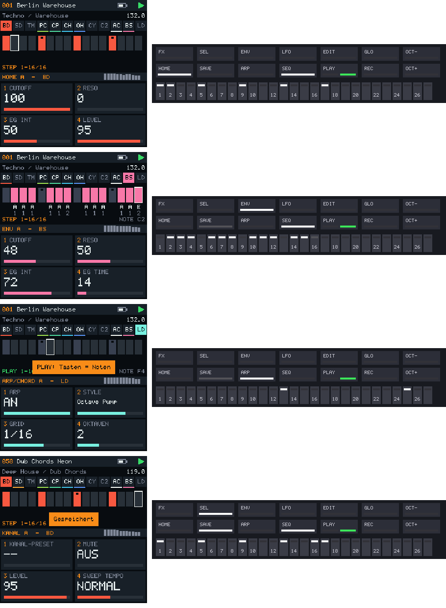

# GrooveDeck FM-1

Eigene Firmware für den **M-VAVE FM-1** auf Basis der Klangerzeugung von [GrooveDeck](https://github.com/acidstefan/GrooveDeck) (Stufe 1): Step-Sequencer mit 16–64 Steps, synthetische ESX-1-artige Drums, Bass und Lead mit 303-Filter, LFOs mit Takt-Sync, Arpeggiator und Chord Variator (32 + 8 Akkordformen), FX und Soundgoodizer mit Auto-Pegel, 440 Werkspresets und 92 Kanal-Presets.

Eigener Code, ohne GPL-Abhängigkeit. Die Hardware-Treiber kommen aus [fm1-nes](https://github.com/Keitark/fm1-nes) (Apache-2.0) und werden nur eingebunden, nicht kopiert (siehe `NOTICE.md`).

## Stand

| Teil | Ordner | Stand |
|---|---|---|
| Klangerzeugung, Sequencer, Arp, Presets | `core/` | fertig, am PC geprüft |
| Bedienoberfläche (240×240), Tasten/Drehgeber, LED-Logik, MIDI-Eingang, Akku-Anzeige | `core/` | fertig, in der PC-Simulation und mit Tests geprüft |
| PC-Werkzeuge und Tests | `host/`, `tests/` | fertig |
| Hardware-Anbindung FM-1, Build-Skript | `target/` | **Entwurf, noch nicht kompiliert** – siehe `target/README.md` |

### Prüfergebnisse

- **Klanggleichheit mit dem Plugin:** Die Original-Engine (`Source/Dsp.h`) und die FM-1-Engine bekommen dieselben Parameter und Noten, für alle 440 Werkspresets:
  - ohne FX: Korrelation 1,000, Pegelabweichung 0,00 dB (sample-genau)
  - mit FX: Korrelation ≥ 0,997, Pegelabweichung 0,00 dB (Delay mit 16 Bit statt 32 Bit)
- Alle 440 Presets laufen ohne Übersteuerung, ohne NaN und ohne Stille.
- **Rechenzeit:** schwerstes Preset ca. 190 Mio. x86-Befehle je Sekunde Audio, davon ca. 100 Mio. Stimmen und ca. 75 Mio. FX/Master. Ein Kern des FM-1 schafft im Emulator-Modell 125 Mio. Befehle/s. Deshalb ist die Engine in zwei Hälften teilbar (zwei Kerne), und es gibt Spar-Schalter (`--lean`). Ob es auf einem Kern reicht, zeigt erst der Emulator.

## Fassungen für das Gerät

- **`fm1open/`**: GrooveDeck auf **FM1 Open**, dem offiziellen Entwicklungspaket von M-VAVE. USB-Update, MIDI (Klinke/USB/Bluetooth), Display, Flash usw. kommen aus M-VAVEs Systembibliothek; Bau unter Windows. Lizenz dieser Fassung: GPLv3. Anleitung: [fm1open/README.md](fm1open/README.md)
- **`target/`**: eigenständige Fassung auf dem JieLi-AC79-SDK und fm1-nes, zum Testen im fm1-emulator (Linux/WSL).

## PC-Werkzeuge bauen (Windows, Linux, macOS)

```
cmake -B build
cmake --build build --config Release
ctest --test-dir build -C Release
```

- `gd_panel`: **Bedienfeld am PC** – Nachbildung des FM-1 mit Display, LEDs, 27 Tasten, 14 Buttons, 7 Drehreglern und MASTER, voller Klang in Echtzeit (dieselbe Software wie die Firmware, ohne Emulator). Braucht SDL2 (`sudo apt install libsdl2-dev`), sonst wird es nicht gebaut.
  - Maus: Tasten/Buttons anklicken (halten = gedrückt halten), Regler mit Mausrad oder durch Ziehen nach oben/unten
  - Tastatur: weiße Tasten `Z X C V B N M , . / Q W E R T Y` (deutsche Tastatur: `Y` statt `Z`, `Z` statt `Y`), schwarze darüber `S D F H J L Ö Ä 3 4 6`; F1 FX, F2 SEL, F3 ENV, F4 LFO, F5 EDIT, F6 GLO, F7 HOME, F8 SAVE, F9 ARP, F10 SEQ, F11/Leertaste PLAY, F12 REC, `Ü`/`+` OCT−/OCT+, Pfeil hoch/runter SELECT, Pfeil links/rechts PRESETS
  - Zoom: Strg + Mausrad, Strg + Plus/Minus, Strg + 0; das Fenster lässt sich frei ziehen
- `gd_render 0 8 preset.wav`: Preset 1 als 8-Sekunden-WAV rendern (zum Anhören)
- `gd_render --list`: alle Presets anzeigen
- `gd_render --all`: alle Presets prüfen (Pegel, NaN, Rechenzeit)
- `gd_sim ausgabe`: Bedienung simulieren, Bildschirmfotos und Bedienfeld mit LEDs (PPM) sowie Ton (WAV) schreiben
- Klangvergleich mit dem Plugin: `cmake -B build -DGROOVEDECK_SOURCE=<Pfad>/GrooveDeck/Source`, danach `compare_ref 0 439 0`

## Bedienelemente und Anschlüsse des FM-1

Status: **umgesetzt** = Verhalten in `core/` programmiert und am PC getestet. **Treiber offen** = die FM-1-Anbindung in `target/` fehlt noch (siehe `target/README.md`). **Hardware** = funktioniert ohne Firmware.

### Übersicht

| Element | Anzahl / Art | GrooveDeck-Funktion | Status |
|---|---|---|---|
| Display | 1,54" TFT, 240 × 240 | Preset, Kanäle, Step-Raster, Reglerseite, Meldungen, Tempo, Akku | umgesetzt, Treiber im Entwurf |
| Drehgeber | 7 endlos (SELECT, PRESETS, ALGORITHM, KNOB 1–4) | siehe unten | umgesetzt, Treiber im Entwurf |
| MASTER | Poti, 300° | Master-Lautstärke | umgesetzt, Treiber im Entwurf |
| Buttons | 14, mit LED | siehe unten | Tasten umgesetzt; LEDs: Logik umgesetzt, Treiber offen |
| PLAY-Button | zusätzlich grüne LED | grün = läuft (blinkt bei externer Clock), weiß = STOP | Logik umgesetzt, Treiber offen |
| Tastatur | 27 Silikontasten, je eine LED | Steps setzen oder spielen; LEDs zeigen Steps/Noten | Tasten umgesetzt; LEDs: Logik umgesetzt, Treiber offen |
| Lautsprecher | eingebaut | Wiedergabe; schaltet beim Einstecken eines Kopfhörers ab | Hardware |
| Audio-Ausgang | 3,5 mm TRS (Kopfhörer/Line) | Stereo-Ausgang der Engine | Treiber im Entwurf (IIS) |
| MIDI-Eingang | 3,5 mm TRS (Adapter auf DIN) | Noten, Controller, MIDI-Clock/Start/Stop | Logik umgesetzt, Treiber offen |
| USB-C | Strom/Laden, USB-MIDI | Laden; USB-MIDI wie TRS-Eingang; später Firmware-Update | Laden: Hardware; MIDI/Update offen |
| Bluetooth-MIDI | BLE | noch nicht unterstützt (HOME lang: Hinweis) | offen |
| Ein/Aus-Schalter | Rückseite | Gerät ein/aus | Hardware |
| Akku | 3,7 V, 2000 mAh | Anzeige im Display, Warnung unter 5 % | Anzeige umgesetzt, Messung offen |

### Drehgeber und MASTER

| Element | Funktion |
|---|---|
| PRESETS | Werkspreset wählen (lädt sofort, die Wiedergabe läuft weiter) |
| SELECT | Kanal wählen: BD SD TM PC CP CH OH CY C2, AC (Akzent), BS (Bass), LD (Lead) |
| ALGORITHM | Tempo; mit gehaltenem OCT− oder OCT+: Transpose −12 … +12 |
| KNOB 1–4 | Regler der aktuellen Seite (Beschriftung unten im Display) |
| MASTER | Master-Lautstärke |

### Buttons

| Button | Drücken | Halten / Kombination | LED |
|---|---|---|---|
| HOME, ENV, LFO, EDIT, FX, GLO, ARP, SEL | Reglerseite wählen; erneut drücken = Seite B | HOME lang: Bluetooth (noch nicht unterstützt) | Seite A: an, Seite B: pulsiert; ARP glimmt, wenn ein Arpeggiator läuft |
| SEQ | Tastatur: STEP (weiße Tasten = Steps, schwarze = Zusatzfunktionen) ↔ PLAY (Tasten spielen) | – | an im STEP-Modus |
| PLAY/STOP | Start/Stopp | – | grün beim Spielen (blinkt bei externer Clock), weiß im Stopp |
| REC | Live-Aufnahme an/aus | – | rot; blinkt, solange angehalten |
| SAVE | – | halten (0,8 s): sichern; SEL + SAVE: Gesichertes laden | glimmt bei ungesicherten Änderungen, hell beim Halten |
| OCT−, OCT+ | STEP: Step-Seite (beim Loslassen); PLAY: Oktave ±3 | beide zusammen: Oktave, Transpose und Step-Seite auf 0; halten + ALGORITHM: Transpose | STEP: zeigt weitere Seiten links/rechts; PLAY: Oktave wie Werks-Firmware (±1 langsam, ±2 schnell blinkend, ±3 an) |

### Tastatur und Tasten-LEDs

Die Klaviatur hat 27 Tasten: unten 16 weiße, oben 11 schwarze. SEQ schaltet zwischen STEP (Steps setzen) und PLAY (spielen).

| Modus | Tasten | LEDs |
|---|---|---|
| STEP | weiße Tasten 1–16: Step an/aus auf der aktuellen Seite (Bass/Lead mit der Step-Note); es klingt nichts | Steps an; laufender Step blinkt; Zählzeiten schwach |
| STEP | schwarze Tasten 1–11: Kanal wählen (BD SD TM PC CP CH OH CY C2 BS LD) · mit OCT− und OCT+ gehalten: Kanal stumm/an · Step-Seiten mit OCT−/OCT+ | gewählter Kanal hell (stumm: blinkt), stumme aus, übrige schwach |
| PLAY, Drums | 1–9 (von links, chromatisch): die neun Drums (Fingerdrumming) | Taste blitzt beim Auslösen des Drums auf, auch vom Sequencer |
| PLAY, Bass/Lead | chromatisch (Oktave/Transpose), über Arp/Chord, falls an; die zuletzt gespielte Note wird Step-Note | alle klingenden Töne, auch vom Arpeggiator und Sequencer |

REC während der Wiedergabe: Gespielte Noten (Tastatur oder MIDI) landen auf dem nächsten Step.

### MIDI-Eingang (TRS und USB)

| Nachricht | Wirkung |
|---|---|
| Note an/aus, Kanal 10 | Drums nach GM-Belegung: 36 BD, 38 SD, Toms, 37/56 Perc, 39 Clap, 42 Hat zu, 46 Hat offen, 49 Crash, 51 Ride |
| Note an/aus, Kanal 1 / 2 | Bass / Lead (über Arp/Chord, falls an) |
| Note an/aus, andere Kanäle | gewählter Kanal |
| CC 74 / CC 71 | Cutoff / Resonanz (Kanal 1 Bass, 2 Lead, sonst gewählter Kanal) |
| CC 7 | Master-Lautstärke |
| CC 120 / 123 | alle Noten aus |
| Clock (24/Viertel) | Tempo folgt der Clock (Anzeige „EXT“) |
| Start / Continue / Stop | Sequencer starten (Start: ab Step 1) / fortsetzen / anhalten |

### Reglerseiten (A / B)

| Seite | A | B |
|---|---|---|
| HOME | Cutoff, Reso, EG Int, Level | Pan, EG Time, Tube, Mute |
| ENV | Cutoff, Reso, EG Int, EG Time | Filtertyp, Modell (SVF/303/Ladder), Acc Sweep, Overdrive |
| LFO | Typ, Tiefe, Tempo, Ziel | Sinus, Noise, BPM-Sync, Takt-LFO |
| EDIT Drums | Pitch, Amp Decay, Low Boost, Pan | Quelle (Sinus/Dreieck), Tube, Roll, Pitch-Mod |
| EDIT Bass/Lead | OSC1, OSC2, OSC2 Pitch, OSC Bal | OSC Mod, Glide, Dist, Tracking |
| FX | FX1 Typ, Edit 1, Edit 2, FX Send | FX2 Typ, Edit 1, Edit 2, FX-Wahl |
| GLO | Tempo, Pattern-Länge (1–64), Gate, Soundgoodizer | Stil, Auto-Pegel, Master Tube, FX-Kette |
| ARP | Arp an, Style, Grid, Oktaven | Chord an, Akkordform, Voicing, Arp Gate |
| SEL | Kanal-Preset, Mute, Level, Sweep-Tempo | – |



## Aufbau

```
core/     hardwareunabhaengig (C99)
  gd_dsp      Engine: Parts, Filter (SVF, 303-Diode, Ladder), LFO, FX, Soundgoodizer
  gd_seq      Sequencer, Keyboard-Routing, Arpeggiator-Laufzeit
  gd_arp      Arpeggiator-Styles, Akkordformen, Voicings
  gd_preset   Preset-Decoder/-Encoder; gd_presets_data.c ist generiert
  gd_app      Bedienlogik und Ereignis-Warteschlange (Bedien-Task -> Audio-Task)
  gd_ui       Display, streifenweise gezeichnet (kein voller Bildspeicher noetig)
  gd_input    Tastenmatrix, Buttons, Drehgeber, MASTER-Poti
  gd_leds     LED-Logik (27 Tasten-LEDs, Button-LEDs, PLAY gruen)
  gd_config.h Groessen und Spar-Schalter
host/     PC-Werkzeuge (WAV-Renderer, Bedien-Simulation)
tests/    Offline-Tests, Klangvergleich mit dem Plugin
tools/    Generatoren (Presets aus dem Plugin, Pixelfont)
target/   FM-1: Einstieg, Build-Skript, Anleitung
```

Presets neu erzeugen, wenn sich die Presets im Plugin ändern:
`python tools/gen_presets_c.py <Pfad>/GrooveDeck/Source`
